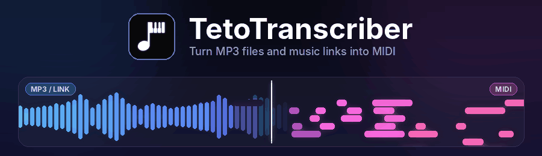

### 🎵 **TetoMIDI turn MP3 files and music links into MIDI** 🎹

Drop in a song or paste a link, and TetoTranscriber converts it to a MIDI file with the [Transkun](https://github.com/Yujia-Yan/Transkun) v2 piano transcription model. Then fix the result in the built-in piano-roll editor.

## 🎶 What is TetoTranscriber?

TetoTranscriber is a Windows desktop app that turns audio into **MIDI notes**. It uses the Transkun v2 model to transcribe piano music, with a black, minimal glass-style interface and an intro animation. The installer ships with **ffmpeg**, so there is nothing else to install.

## 🚀 How to use

1. 📂 **Drag and drop** an audio file onto the window, or click it to choose one. Or paste a **YouTube, SoundCloud or TikTok link** into the box below it.
2. ▶️ Press **Convert** (Enter also works for a pasted link). A progress bar shows how far along it is.
3. 📁 When it finishes, open the folder, or press **Open in Editor** to tweak the MIDI right away.

## ✨ Features

- 🎧 **Many input formats** — MP3, M4A, WAV and MP4 files, up to 10 minutes each.
- 🔗 **Music links** — paste a link from `youtube.com`, `youtu.be`, `soundcloud.com` or `tiktok.com`. The audio is downloaded with [yt-dlp](https://github.com/yt-dlp/yt-dlp) and converted like any other file, and the MIDI is named after the track title. One track at a time (no playlists or livestreams), up to 10 minutes.
- 📊 **Live progress** — a progress bar with a percentage, or the elapsed time when no percentage is available.
- 🖥️ **Console** — the `>_` button opens a log of everything ffmpeg and Transkun print, handy for finding errors.
- 📝 **MIDI Editor** — a piano-roll editor that can open any `.mid` file:
  - ➕ Click the grid to add a note and drag to set its length. Right-click deletes a note.
  - 🖱️ Click to select, **Shift** for several notes, **Ctrl+A** for all. Drag to move, drag the right edge to resize.
  - ⌨️ **Delete** removes, **↑ / ↓** moves by a semitone (**Shift** = octave), **← / →** shifts along the grid.
  - 📐 **Quantize** snaps the selected notes to the grid (from 1/64 up to a whole bar).
  - ↩️ **Ctrl+Z** undo · 💾 **Ctrl+S** save · 📂 **Ctrl+O** open · 🔍 **Ctrl + mouse wheel** zoom.
  - 📥 **Save to Downloads** saves a copy to your Downloads folder (a `(1)`, `(2)` is added if the name is taken).
  - 🔊 **Play with a SoundFont** — choose a `.sf2` file and press **Space** to hear the MIDI. (`.sf3` is not supported.)
- 🍪 **Cookies (optional)** — if YouTube or TikTok blocks your connection, load a `cookies.txt` exported from your browser. A **Check** button tests it for you.
- 📁 **Settings** — choose the MIDI output folder (default `Music\TetoTranscriber`), show the app logo as the folder icon, and open the folder after each conversion.
- 🧭 **Sidebar** — click the icon in the top-left corner to slide out Convert, MIDI Editor, Settings and Discord. Press **Esc** to close it.

## 📝 Notes

- ⏳ The first conversion can be slower because the model has to load.
- 🧠 Transcription runs on the **CPU**.
- 🎹 The model is built for **piano** music, so other instruments may transcribe less accurately.

## 💬 Community

- 💜 Discord: **https://discord.gg/peaqm6uqgB**

## 🙏 Credits

- [Transkun](https://github.com/Yujia-Yan/Transkun) — piano transcription model
- [yt-dlp](https://github.com/yt-dlp/yt-dlp) — downloading audio from links
- [ffmpeg](https://ffmpeg.org/) — audio conversion

🎵 Happy transcribing! 🎵

